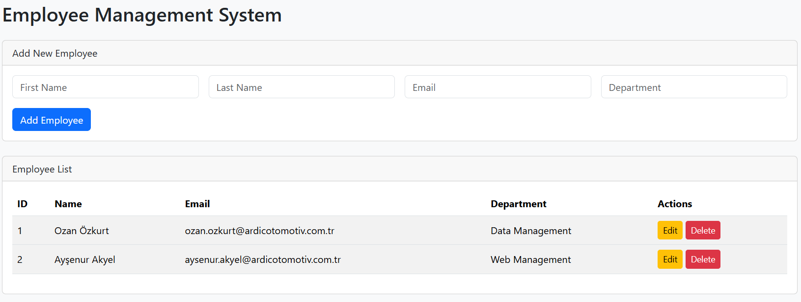
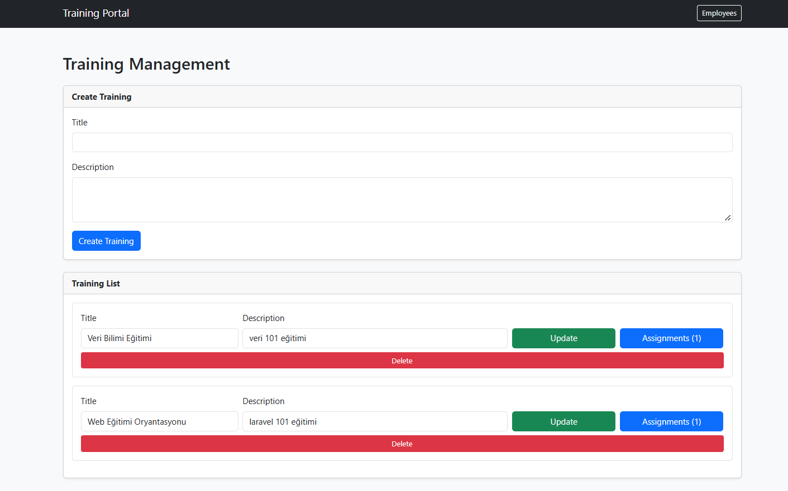
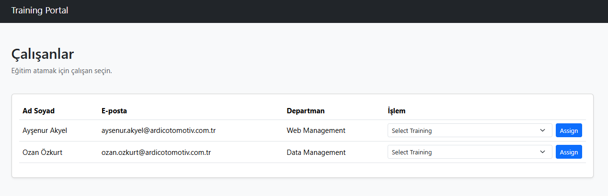
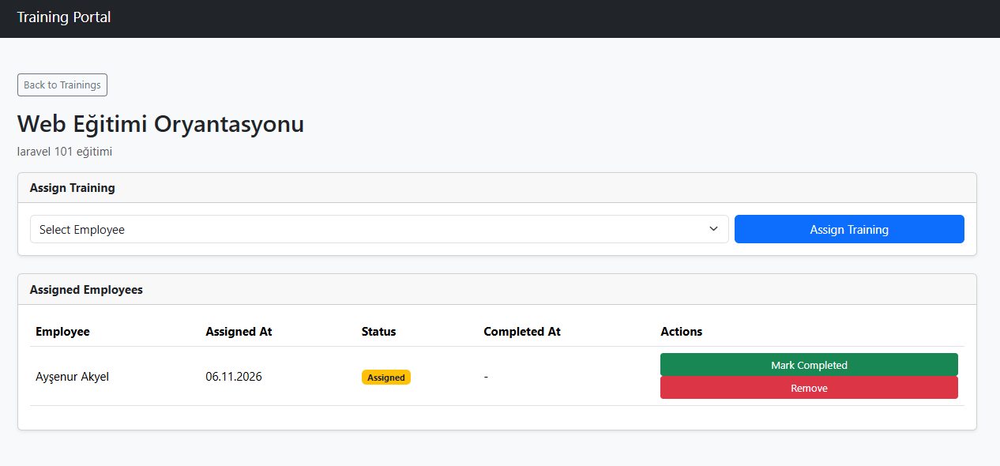
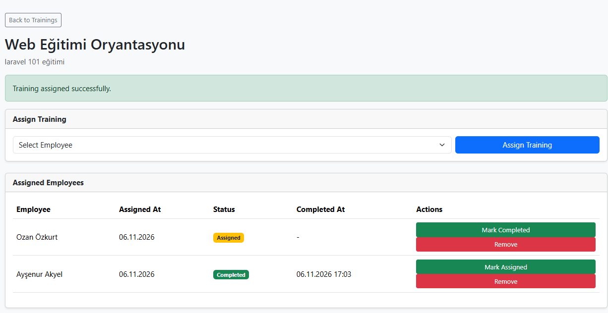

# Employee Training Management System

A two-application system developed with Laravel and PostgreSQL to manage employees, trainings, and training assignments.

## Architecture

The project consists of two independent Laravel applications:

### 1. Employee API
- Manages employee records.
- Provides RESTful API endpoints for employee CRUD operations.
- Uses Bearer Token authentication to secure API access.

### 2. Training Portal
- Retrieves employee information through the Employee REST API.
- Creates, updates, and deletes trainings.
- Assigns trainings to employees.
- Tracks training completion status.

## System Architecture

```text
EmployeeTrainingSystem
│
├── employee_api_app/
│   └── Employee Management
│       └── PostgreSQL: employee_database
│
└── training_portal_app/
    └── Training Management
        └── PostgreSQL: training_database
```

The applications use separate databases and communicate exclusively through REST API requests. The Training Portal does not directly access the Employee API database.

## Development Environment

- Visual Studio Code
- Laravel Herd
- PostgreSQL

## Technologies

- PHP 8.4.24
- Laravel 13.40.0
- PostgreSQL
- REST API
- Laravel HTTP Client
- Bearer Token Authentication
- Bootstrap 5

## Requirements

- PHP 8.4.24
- Laravel 13.40.0
- Composer
- PostgreSQL

## Installation Employee Management System

### Requirements
- PHP
- Composer
- PostgreSQL
- Laravel

### 1. Clone the Repository

```bash
git clone https://github.com/ac265/EmployeeTrainingSystem.git
cd employee_api_app
```

### 2. Configure PHP Path (Laravel Herd)

If PHP is installed through Laravel Herd, run the following command in PowerShell:

```powershell
$env:Path = "$env:USERPROFILE\.config\herd\bin;" + $env:Path
```

### 3. Install Dependencies

```bash
composer install
```

### 4. Environment Configuration

Create your environment file:

```bash
copy .env.example .env
```

Generate the application key:

```bash
php artisan key:generate
```

### 5. Create the PostgreSQL Database

Create a PostgreSQL database named `employee_management`.

You can create the database using pgAdmin:

1. Open pgAdmin.
2. Connect to your PostgreSQL server.
3. Right-click **Databases**.
4. Select **Create → Database**.
5. Enter `employee_management` as the database name.
6. Save.

Alternatively, execute the following SQL command:

```sql
CREATE DATABASE employee_management;
```

### 6. Configure Database Connection

Update the database settings in the `.env` file:

```env
DB_CONNECTION=pgsql
DB_HOST=127.0.0.1
DB_PORT=5432
DB_DATABASE=employee_management
DB_USERNAME=postgres
DB_PASSWORD=your_password
```

Replace `your_password` with your PostgreSQL password.

### 7. Run Database Migrations

Create the database tables:

```bash
php artisan migrate
```

### 8. Start the Application

```bash
php artisan serve --port=8000
```

The application will be available at:

`http://127.0.0.1:8000`

## Installation Training Management System

### Requirements
- PHP
- Composer
- PostgreSQL
- Laravel

### 1. Clone the Repository

```bash
git clone https://github.com/ac265/EmployeeTrainingSystem. (same folder not install again)
cd training_api_app
```

### 2. Configure PHP Path (Laravel Herd)

If PHP is installed through Laravel Herd, run the following command in PowerShell:

```powershell
$env:Path = "$env:USERPROFILE\.config\herd\bin;" + $env:Path
```

### 3. Install Dependencies

```bash
composer install
```

### 4. Environment Configuration

Create the `.env` file:

```bash
copy .env.example .env
```

Generate the application key:

```bash
php artisan key:generate
```

### 5. Create PostgreSQL Database

Create a PostgreSQL database named `training_management`.

You can create it using pgAdmin:

1. Open pgAdmin.
2. Connect to your PostgreSQL server.
3. Right-click **Databases**.
4. Select **Create → Database**.
5. Enter `training_management`.
6. Save.

Alternatively, execute:

```sql
CREATE DATABASE training_management;
```

### 6. Configure Database Connection

Update your `.env` file:

```env
DB_CONNECTION=pgsql
DB_HOST=127.0.0.1
DB_PORT=5432
DB_DATABASE=training_management
DB_USERNAME=postgres
DB_PASSWORD=your_password
```

Replace `your_password` with your PostgreSQL password.

### 7. Run Migrations

```bash
php artisan migrate
```

### 8. Start the Application

```bash
php artisan serve --port=8001
```

The application will be available at:

`http://127.0.0.1:8001`

## Running the Applications

Start the Employee API:

```bash
cd employee_api_app
php artisan serve --port=8000
```

Start the Training Portal in a separate terminal:

```bash
cd training_portal_app
php artisan serve --port=8001
```

## Application URLs

- Employee API: http://127.0.0.1:8000
- Employee API endpoint: http://127.0.0.1:8000/api/employees
- Training Portal: http://127.0.0.1:8001

## Security

API communication is protected using Bearer Token authentication. The Employee API validates incoming tokens through middleware. Invalid or missing tokens receive a `401 Unauthorized` response.

Each application has its own environment configuration and database.

## Project Structure

```text
EmployeeTrainingSystem/
├── employee_api_app/
├── training_portal_app/
├── screenshots
└── README.md
```

## Screenshots

### Employee Management


### Training Management


### Training Employees


### Training Assignments


### Training Status


## Demo

[Watch Project Demo](screenshots/demo.mp4)